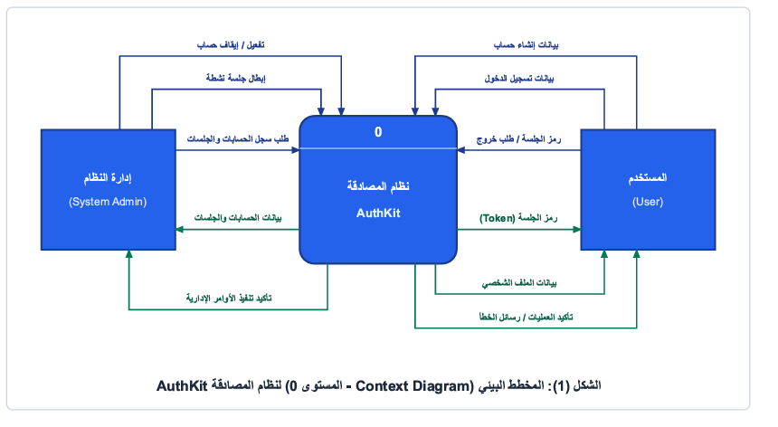
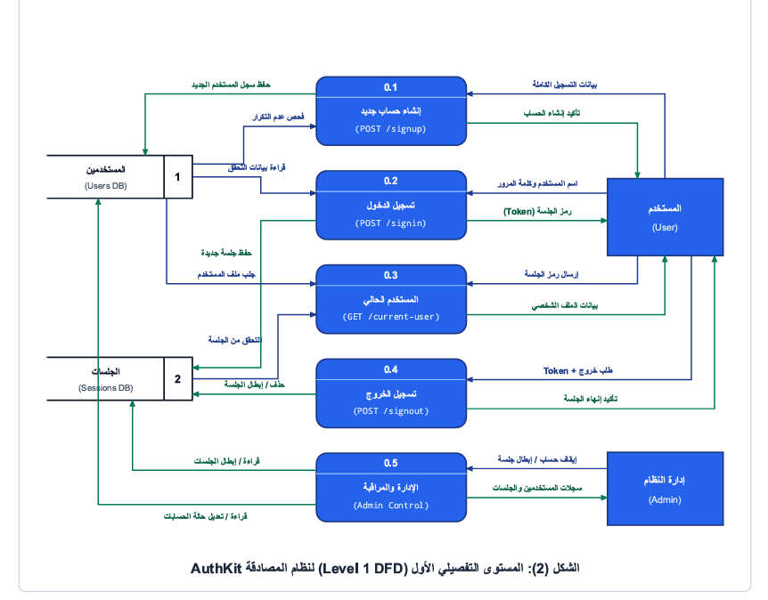
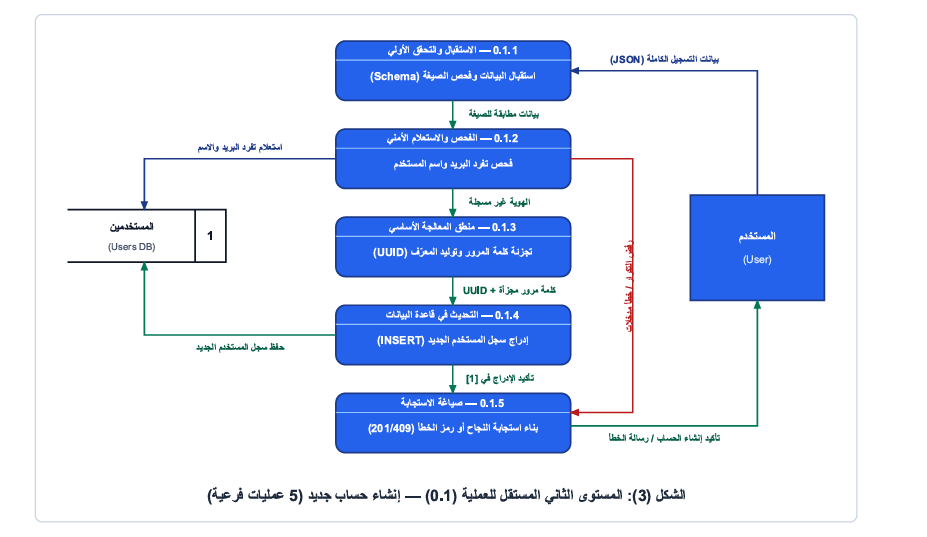
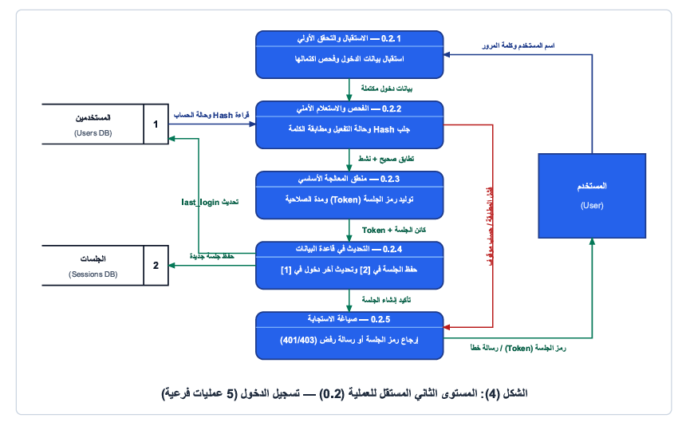
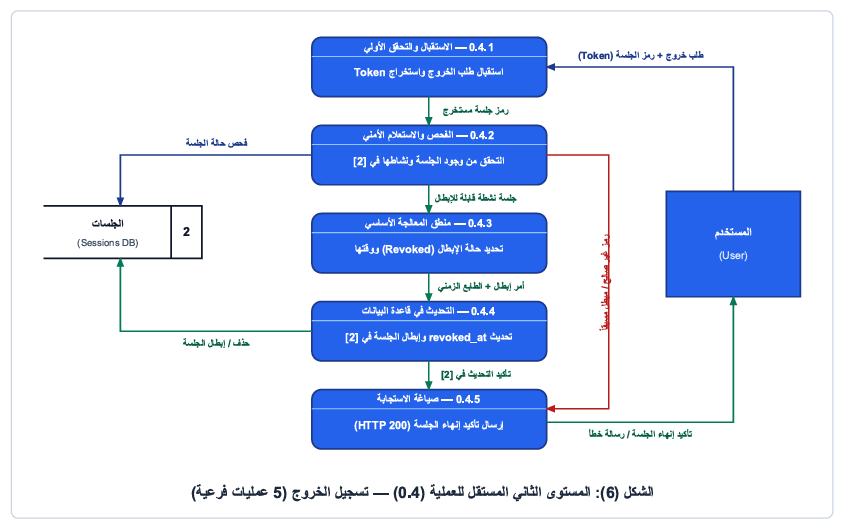
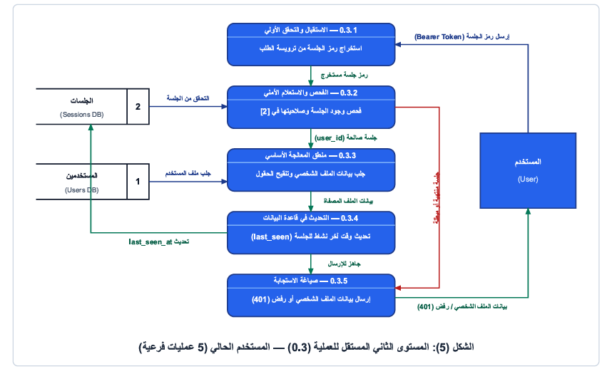
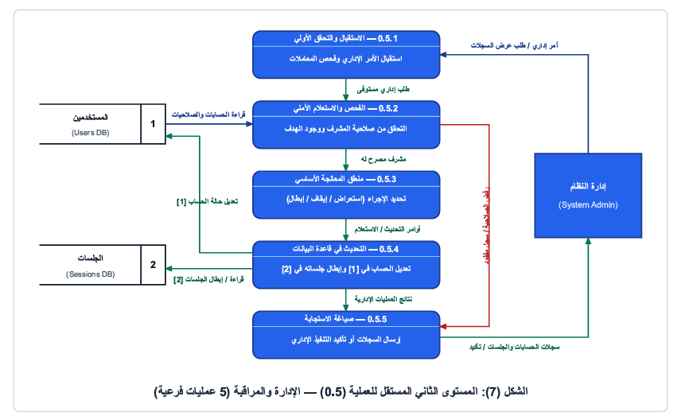

# مخططات تدفق البيانات (DFD)

يمثل مخطط تدفق البيانات (Data Flow Diagram) طريقة عرض مرئية لكيفية انتقال البيانات داخل النظام، وكيف تتفاعل العمليات مع المستخدمين ومخازن البيانات.

يساعد DFD على فهم مدخلات النظام ومخرجاته والعمليات التي تعالج البيانات وتخزينها دون الدخول في تفاصيل تقنية التنفيذ.

## مستويات المخططات

- مخطط السياق: يعرض النظام كعملية واحدة وعلاقته بالأطراف الخارجية.
- مخطط المستوى الأول: يقسم النظام إلى العمليات الرئيسية ومخازن البيانات وتدفقات المعلومات بينها.
- مخططات المستوى الثاني: تفصل عمليات محددة وتوضح تفاصيل تدفق البيانات داخل كل عملية.

## مخططات المشروع

### 1. مخطط السياق

يعرض مخطط السياق النظام كاملاً بصفته عملية رئيسية واحدة. يوضح المخطط الأطراف الخارجية التي تتفاعل مع النظام، مثل المستخدم والمطور ومسؤول النظام، ويعرض تدفقات البيانات الأساسية بين هذه الأطراف والنظام دون الدخول في تفاصيل العمليات الداخلية.

### 2. مخطط المستوى الأول

يقسم مخطط المستوى الأول النظام إلى عمليات المصادقة الرئيسية ومخازن البيانات المستخدمة لتخزين معلومات المستخدمين والجلسات والصلاحيات. يوضح كيفية انتقال البيانات من كل طرف إلى العملية المناسبة، ويبين خروج النتائج والاستجابات من النظام.

### 3. مخطط المستوى الثاني - التسجيل

يفصل المخطط عملية إنشاء الحساب إلى خطوات فرعية، ويعرض إدخال بيانات التسجيل والتحقق من صحتها وفحص تكرار اسم المستخدم والبريد الإلكتروني، ثم حفظ البيانات وإنشاء الحساب وإرجاع النتيجة للمستخدم.

### 4. مخطط المستوى الثاني - تسجيل الدخول

يوضح المخطط تفاصيل عملية تسجيل الدخول، حيث يتم استقبال بيانات الاعتماد والتحقق منها، والبحث عن المستخدم، ثم إنشاء الجلسة وإرجاع رمز الجلسة عند نجاح العملية، أو إرجاع رسالة فشل عند بيانات الاعتماد غير الصحيحة.

### 5. مخطط المستوى الثاني - تسجيل الخروج

يوضح المخطط عملية إنهاء الجلسة، وتشمل استقبال بيانات الجلسة والتحقق من معرفها وإلغاء الجلسة وتحديث حالتها في مخزن الجلسات، ثم إرجاع تأكيد نجاح تسجيل الخروج للمستخدم.

### 6. مخطط المستوى الثاني - المستخدم الحالي

يعرض المخطط استرجاع بيانات المستخدم المرتبط بالجلسة الحالية. يتم إرسال الطلب مع بيانات الجلسة، والتحقق من صلاحيتها، ثم جلب بيانات المستخدم من مخزن المستخدمين وإرجاعها كاستجابة ناجحة، أو رفض الطلب عند عدم صلاحية الجلسة.

### 7. مخطط المستوى الثاني - التحكم الإداري

يوضح المخطط تدفق العمليات الإدارية، ويبين التحقق من أن المستخدم هو مشرف مفعل قبل السماح بتنفيذ الإجراء المطلوب، ومنع العملية وإرجاع خطأ صلاحية عند عدم وجود إذن إداري.

