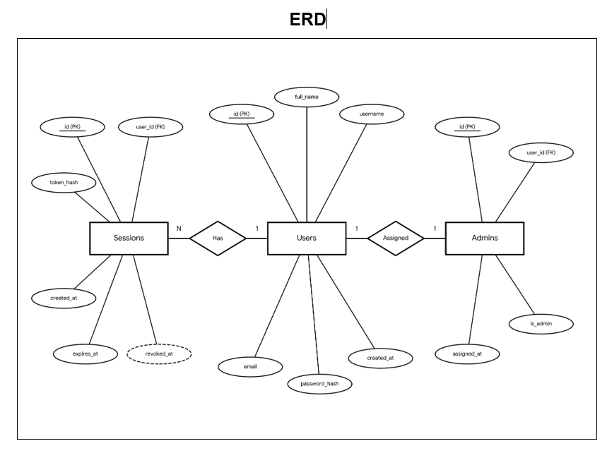

# مخطط العلاقات بين الكيانات (ERD)

يعرّف مخطط العلاقات بين الكيانات (Entity-Relationship Diagram) بنية بيانات النظام من خلال عرض الكيانات والسمات والعلاقات بينها.

يساعد مخطط ERD على توضيح كيفية ربط حسابات المستخدمين والمديرين والجلسات، وتحديد المفاتيح الأساسية والأجنبية والقيود التي تحكم البيانات.

## مخطط ERD العام للنظام

يوضح المخطط العلاقات الهيكلية بين جداول النظام، ويعرض المفاتيح الأساسية لكل جدول والمفاتيح الأجنبية التي تربط الجداول ببعضها. كما يوضح علاقة المستخدمين بالجلسات وعلاقة حساب المستخدم المقيد ببيانات المشرف.

## الكيانات الأساسية المتوقعة

- **Users:** يمثل المستخدمين العاديين وبيانات اعتماداتهم.
- **Admins:** يمثل الصلاحيات الإدارية المرتبطة بحسابات المستخدمين.
- **Sessions:** يمثل جلسات المستخدم النشطة والمنتهية أو الملغاة.

## العلاقات

- **Users إلى Sessions:** علاقة 1:N؛ لكل مستخدم جلسات متعددة، وتربط الجلسة بالمستخدم عبر `Sessions.user_id`.
- **Users إلى Admins:** علاقة 1:1؛ يرتبط سجل المشرف بحساب مستخدم واحد فقط عبر `Admins.user_id`.

تفاصيل الحقول وأنواع البيانات والمفاتيح والقيم الفارغة موثقة في [قاموس البيانات](../Data_Dictionary/DATABASE_DATA_DICTIONARY.md).

