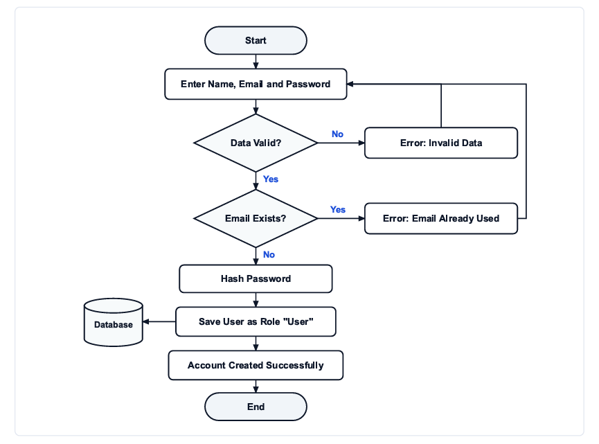
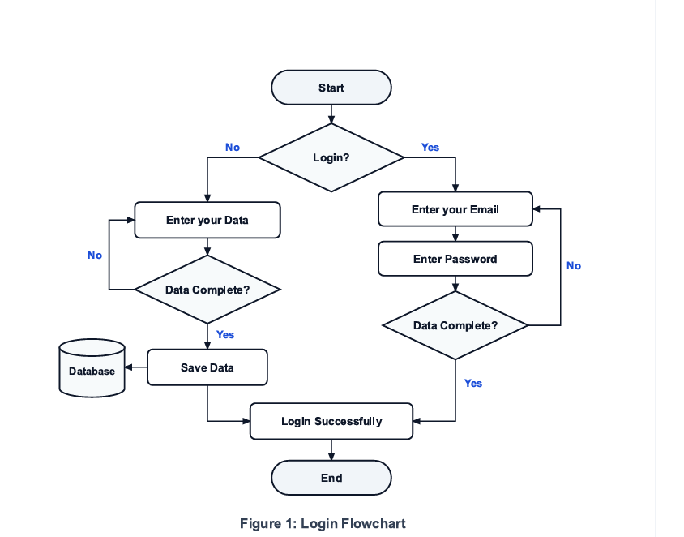
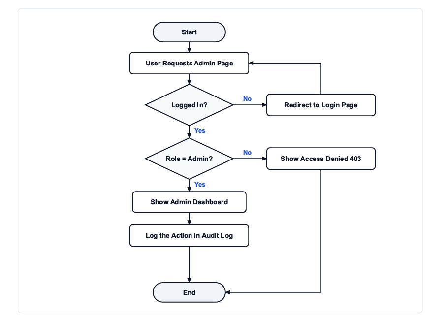
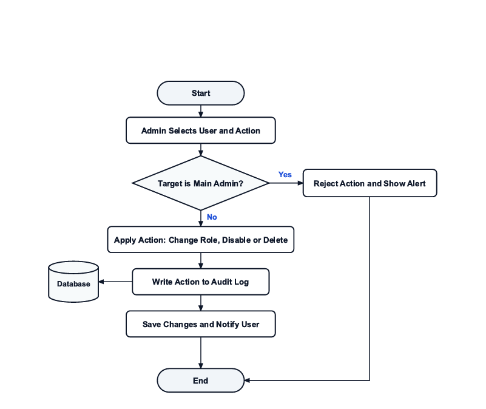

# مخططات التدفق (Flow Charts)

توضح مخططات التدفق تسلسل خطوات العمليات واتجاه سير التنفيذ ونقاط اتخاذ القرار في وظائف النظام.

تسهل مخططات التدفق فهم المسارات الممكنة للعمليات، بما يشمل المسارات الناجحة ومسارات الأخطاء والفشل والاستثناءات.

## صور مخططات التدفق

### 1. مخطط تدفق إنشاء الحساب

يوضح المخطط المسار الكامل لإنشاء حساب، بما في ذلك إدخال البيانات والتحقق منها، وفحص تكرار الحساب، وحفظ البيانات، وإرجاع النتيجة الناجحة أو رسالة الخطأ.

### 2. مخطط تدفق تسجيل الدخول

يوضح المخطط تسلسل عملية تسجيل الدخول، ويحتوي على نقطة تحقق من صحة بيانات الاعتماد ومسار النجاح الذي ينشئ الجلسة ومسار الفشل الذي يعيد نتيجة رفض الدخول.

### 3. مخطط تدفق التحقق من الصلاحية

يوضح المخطط قرار السماح أو منع المستخدم من تنفيذ العملية بناءً على الجلسة وصلاحية المستخدم أو المشرف.

### 4. مخطط تدفق الإجراء الإداري

يوضح المخطط تنفيذ إجراء إداري من البداية إلى النهاية، ويشمل التحقق من صلاحية المشرف، والانتقال إلى الإجراء المطلوب عند النجاح، وإرجاع رفض العملية عند عدم وجود الصلاحية.

