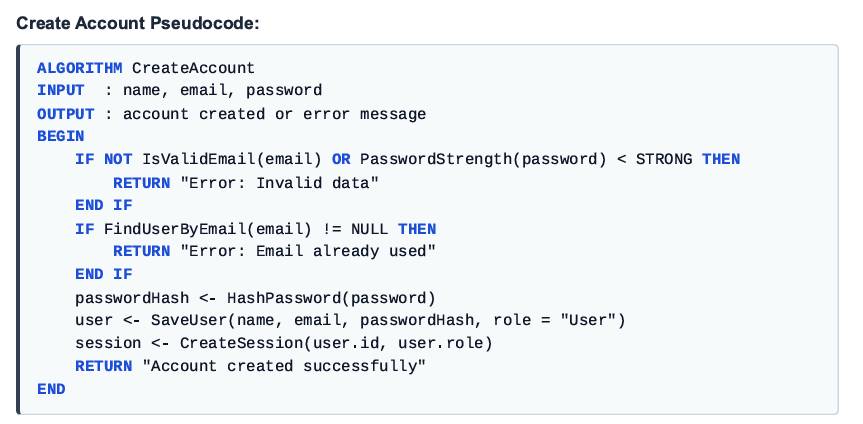
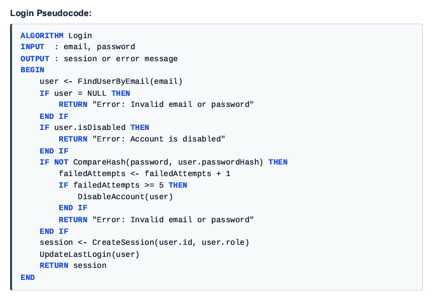
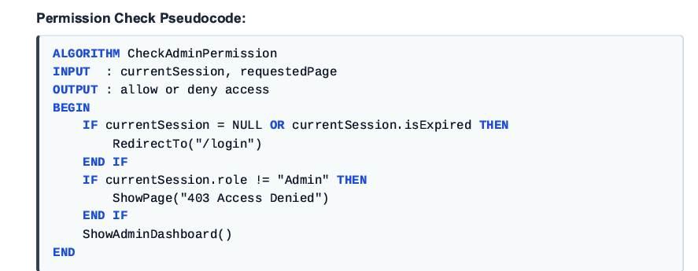
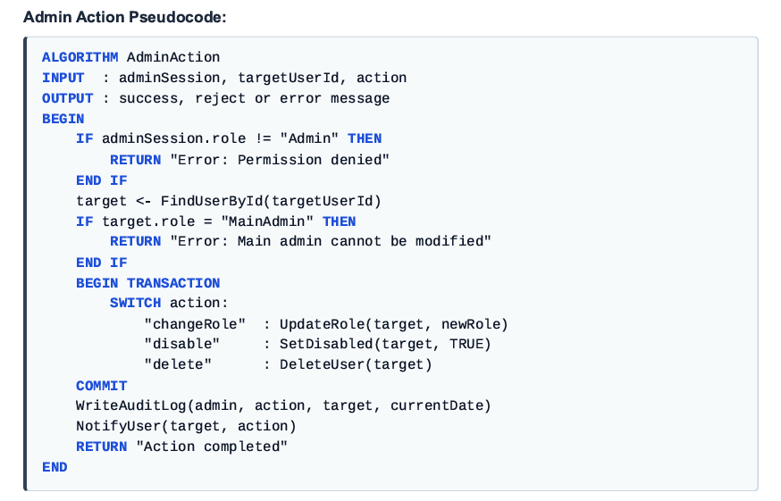

# الخوارزميات (Algorithms)

توصف الخوارزميات في هذا القسم الخطوات المنطقية والإجراءات المتتابعة التي ينفذها النظام لمعالجة البيانات واتخاذ القرارات.

يهدف توثيق الخوارزميات إلى توضيح آلية تنفيذ العمليات البرمجية بشكل مستقل عن لغة البرمجة، مثل التحقق من بيانات الاعتماد وإنشاء الجلسات والتحقق من صلاحيتها.

## صور الخوارزميات

### 1. خوارزمية إنشاء الحساب

توضح الصورة الخطوات المنطقية لإنشاء حساب جديد، وتشمل استقبال البيانات والتحقق من صحتها وفحص عدم تكرار اسم المستخدم والبريد الإلكتروني، ثم تجزئة كلمة المرور وحفظ الحساب في قاعدة البيانات.

### 2. خوارزمية تسجيل الدخول

توضح الصورة كيفية استقبال بيانات الاعتماد، والبحث عن المستخدم، ومقارنة كلمة المرور، وإنشاء جلسة جديدة ورمز تحقق عند نجاح تسجيل الدخول، مع إرجاع خطأ عند فشل الاعتماد.

### 3. خوارزمية التحقق من الصلاحية

توضح الصورة التحقق من ارتباط المستخدم بالجلسة ومن حيازته صلاحيات المشرف عند تنفيذ عملية تحتاج إلى صلاحيات إدارية.

### 4. خوارزمية تنفيذ إجراء إداري

توضح الصورة خطوات تنفيذ عملية إدارية بعد التحقق من هوية المستخدم وصلاحياته، ورفض الإجراء عند عدم امتلاك الصلاحية المطلوبة.

