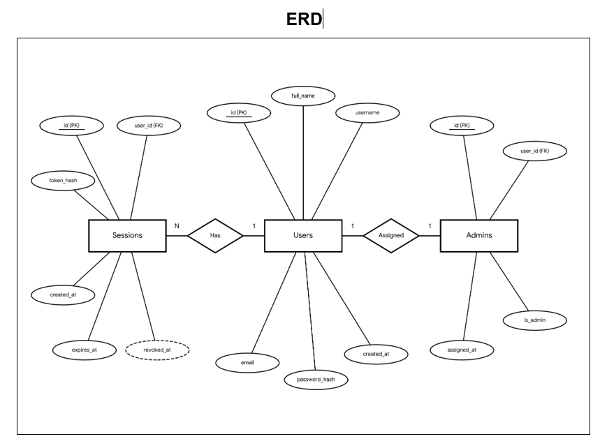

# مخطط العلاقات بين الكيانات (ERD)

يعرّف مخطط العلاقات بين الكيانات (Entity-Relationship Diagram) بنية بيانات النظام من خلال عرض الكيانات والسمات والعلاقات بينها.

يساعد مخطط ERD على توضيح كيفية ربط حسابات المستخدمين وجلساتهم، وتحديد المفاتيح الأساسية والأجنبية والقيود التي تحكم البيانات. الصلاحية الإدارية صفة يملكها حساب المستخدم ولا تمثل كيانا مستقلا.

## مخطط ERD العام للنظام

يوضح المخطط العلاقات الهيكلية بين جداول النظام، ويعرض المفاتيح الأساسية لكل جدول والمفاتيح الأجنبية التي تربط الجداول ببعضها. كما يوضح علاقة المستخدمين بالجلسات وعلاقة حساب المستخدم المقيد ببيانات المشرف.

## الكيانات الأساسية المتوقعة

- **Users:** يمثل المستخدمين العاديين وبيانات اعتماداتهم.
- **Users.is_admin:** يمثل حالة الصلاحية الإدارية لحساب المستخدم؛ ولا توجد جدول مستقل للمديرين.
- **Sessions:** يمثل جلسات المستخدم النشطة والمنتهية أو الملغاة.

## العلاقات

- **Users إلى Sessions:** علاقة 1:N؛ لكل مستخدم جلسات متعددة، وتربط الجلسة بالمستخدم عبر `Sessions.user_id`.
- لا توجد علاقة مستقلة من Users إلى Admins؛ تتحقق الإجراء الإداري من قيمة `Users.is_admin`.

تفاصيل الحقول وأنواع البيانات والمفاتيح والقيم الفارغة موثقة في [قاموس البيانات](../data_dictionary/database_data_dictionary.md).

